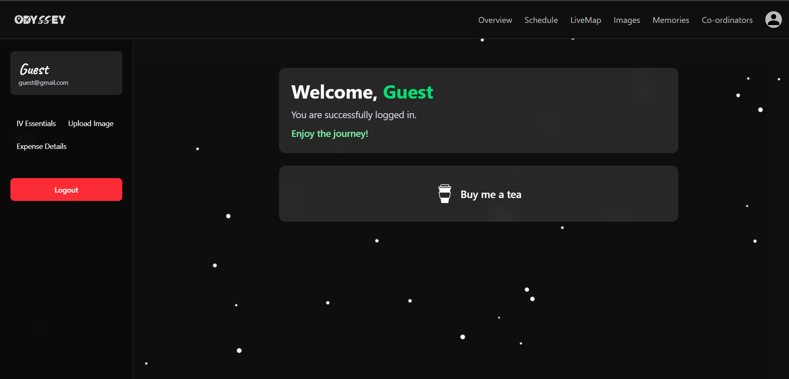
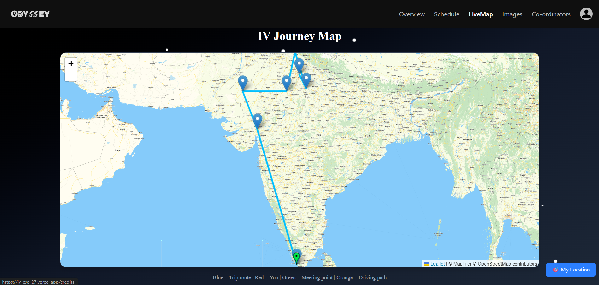
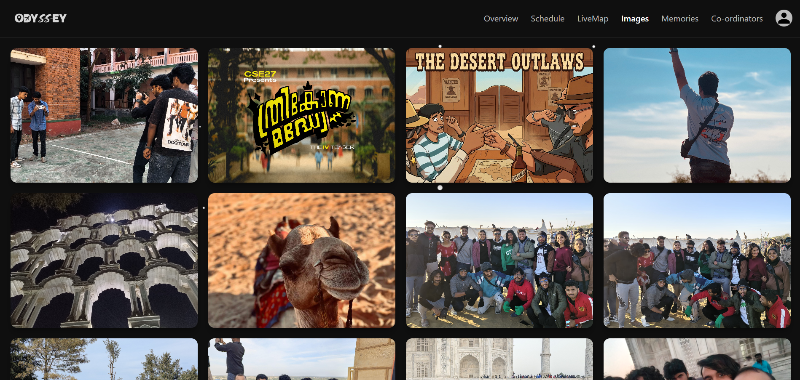

# 🚌 ODYSSEY

A comprehensive management system designed to streamline **Industrial Visits**. It facilitates real-time tracking, secure media sharing, and seamless coordination between students and administrators.

---

## 🚀 Features

- **🔐 Dual-Role Authentication**: Dedicated secure login portals for both Students and Administrators.
- **📍 Real-Time Location Updates**: Live tracking of the trip progress to keep participants and stakeholders informed.
- **🖼️ Smart Media Gallery**:
  - **Public Images**: Highlights and general photos accessible to the public or all students.
  - **Private Images**: Secure, restricted access for specific trip participants and authenticated users.
- **📋 Coordinator Directory**: A centralized list of student coordinators with contact details for quick communication.
- **📱 Responsive Design**: Optimized for mobile use to ensure accessibility while on the move during the visit.

---

## 📸 Screenshots

_Managing trip logistics and images_

_Real-time location updates and map integration_

_Browsing public and private trip memories_

---

## 🛠️ Technologies Used

- **Frontend**: React.js Tailwind CSS
- **Backend**: Node.js, Express
- **Database**: Firestore
- **Authentication**: JWT with Role-Based Access Control (RBAC)
- **Storage**: Supabase

---

## 🌐 Live Demo

Try the app live here:  
👉 [Odyssey](https://iv-cse-27.vercel.app/)  
(_Feel free to explore the website!_)

---

## 🎥 Screencast Walkthrough

Watch a short demo of the system in action:  
📺 [IV Portal Walkthrough](https://drive.google.com/file/d/10dJJp2ua9f5jp01DIehCeB7ucFGhtl_o/view?usp=sharing)  
(_Covers location updating, admin dashboard, and gallery access controls._)

---
